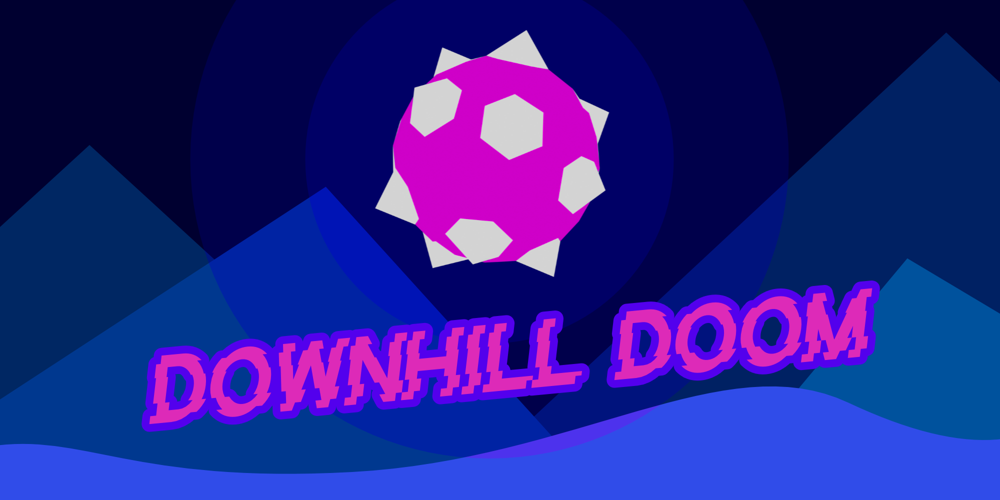
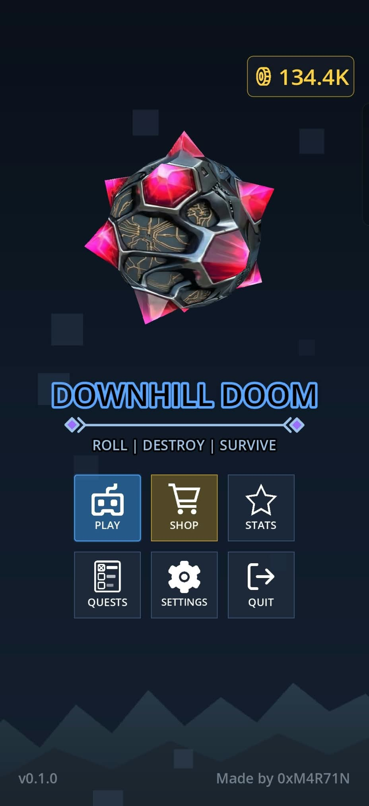
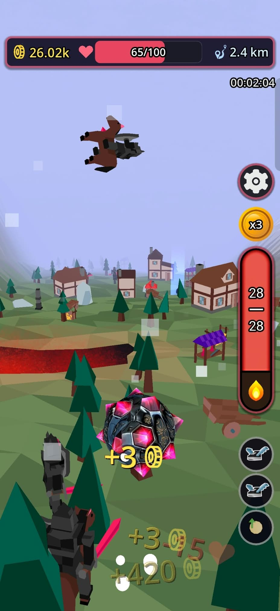
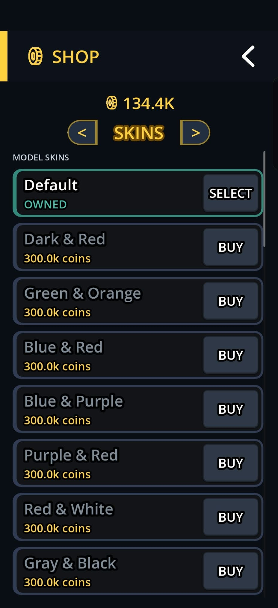
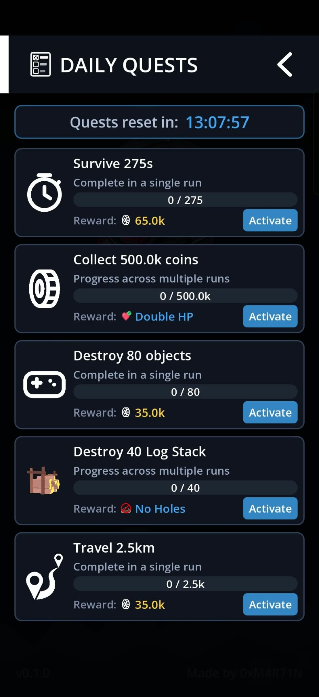
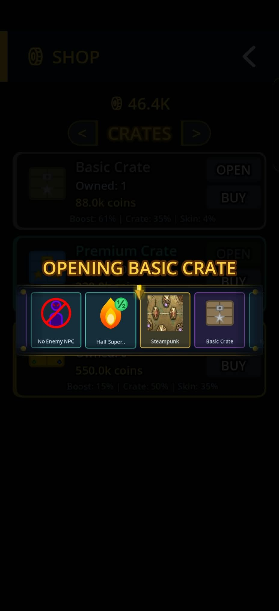

	
	<h1>Downhill Doom</h1>
	
<strong>Roll downhill. Smash through everything. Get rich.</strong>

	

		
	

	

		
		
		
	

## 🎮 About Downhill Doom

Downhill Doom is a mobile arcade game inspired by *Giant Boulder of Death*. Take control of a boulder rolling downhill, smash through obstacles to earn coins, and spend your haul on items in the shop.

## 🕹️ How to Play

- **Steer:** Tilt your phone left or right to guide the boulder. Prefer touch? Switch the control mode in Settings and steer with the on-screen joystick.
- **Jump:** Tap the on-screen Jump button.
- **Slam:** While airborne, tap Jump again to slam down immediately and unleash a shockwave on impact.

## 📸 Screenshots

| Main Menu | In Game |
|:---:|:---:|
|  |  |

| Shop | Daily Quests | Crate Opening |
|:---:|:---:|:---:|
|  |  |  |

## 🙌 Credits

### 🎨 Used Assets

#### 🌌 Visual Assets

- AllSky by Distant Lantern

#### 🔊 Sound Effects

- Squeaky Rat by Iwan 'qubodup' Gabovitch ([OpenGameArt](http://opengameart.org/users/qubodup))
- Chicken Sound Effect by IMadeIt
- Concrete SMASH 2 by magnuswaker
- Explosion In The Air by miksmusic
- male_hurt13 by micahlg
- Wood Crash by DiscordantScraps
- Powerup 08 by LilMati
- Jet Plane Wind Noise Loop of a KC-135 Stratotanker by qubodup
- Bovines - Cattle by TheKingOfGeeks360
- Sheep baa. From recording by mikewest.
- Teleport - Rpg by colorsCrimsonTears
- Wood Break by BOAAY
- meow51252153 by suicdxsaturday
- Beagle_Bark_Exterior by n_audioman
- Penguin Squeak by Breviceps
- Mechanical Plastic Click by SmallConfusion
- Loot box open by NeoSpica
- Item or Material Pickup Pop 1 of 3 by el_boss
- Synth chiptune 8 bit ui interface item use health power up by ryusa

### ✨ Special Skins

All special skins were created by **0xM4R71N** using AI tools and refined through post-production.

## 👤 Author

**0xM4R71N** — [github.com/0xMartin](https://github.com/0xMartin). Creator of Downhill Doom and all 3D models featured in the game.